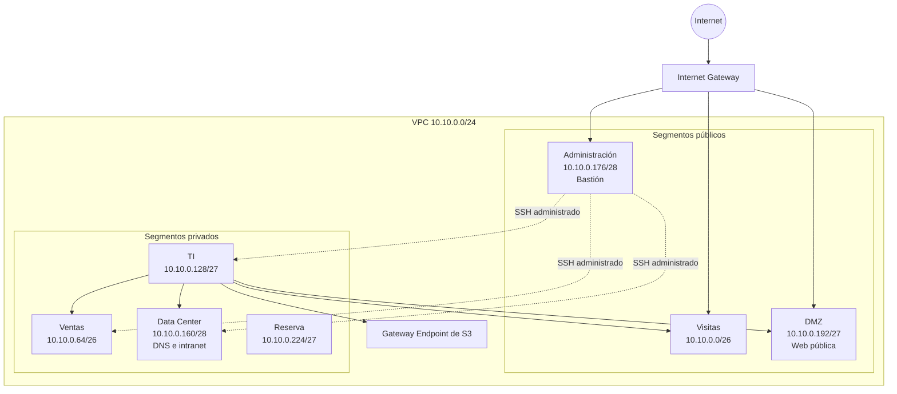
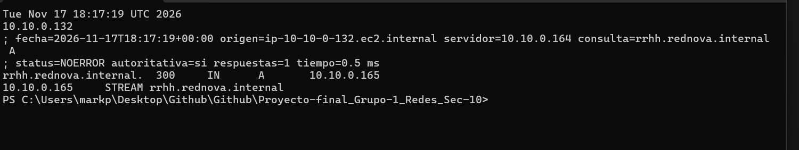
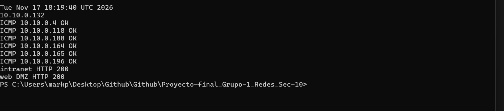
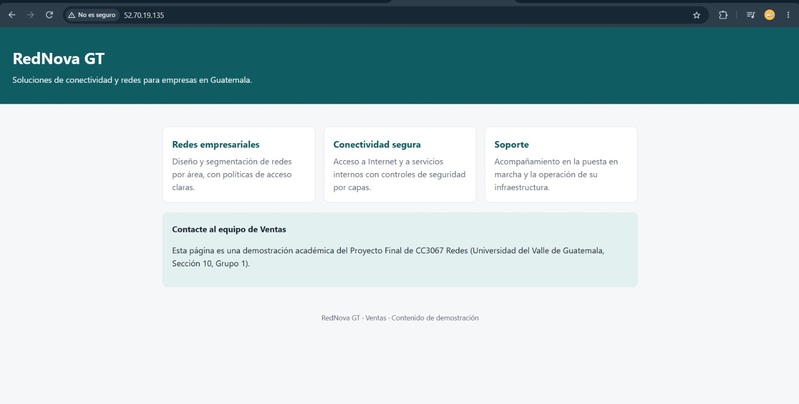

<div align="center">

# RedNova GT · Infraestructura de red en AWS

### Proyecto final de Redes · Fases 1 y 2

**Universidad del Valle de Guatemala**<br>
CC3067 Redes · Sección 10 · Grupo 1

`AWS` · `Terraform` · `VPC` · `EC2` · `BIND9` · `Nginx` · `nftables`

</div>

---

## Descripción

RedNova GT representa una red empresarial segmentada y reproducible sobre Amazon Web Services.
La solución utiliza una VPC `10.10.0.0/24`, infraestructura como código y controles de seguridad
en varias capas para separar usuarios, administración, servicios internos y exposición pública.

La Fase 1 establece el direccionamiento, las subredes, las rutas y la conectividad base. La Fase 2
amplía esa arquitectura con una DMZ, DNS interno, intranet de Recursos Humanos, web pública y
clientes temporales para comprobar las políticas de Visitas y TI.

> **Estado actual:** implementación completa, ventana AWS ejecutada y cierre auditado. La suite
> produjo 36 resultados correctos, 3 omisiones documentadas y 0 contradicciones. No se versionaron
> llaves, credenciales, planes binarios ni estado.

## Arquitectura



### Segmentación IPv4

| Segmento | CIDR | Propósito | Exposición |
|---|---|---|---|
| Visitas | `10.10.0.0/26` | Cliente temporal y navegación controlada | Pública |
| Ventas | `10.10.0.64/26` | Usuarios internos | Privada |
| TI | `10.10.0.128/27` | Administración y pruebas autorizadas | Privada |
| Data Center | `10.10.0.160/28` | DNS e intranet | Privada |
| Administración | `10.10.0.176/28` | Bastión de acceso | Pública controlada |
| DMZ | `10.10.0.192/27` | Web pública de Ventas | Pública |
| Reserva | `10.10.0.224/27` | Crecimiento futuro | Sin asignar |

## Componentes principales

### Infraestructura

- VPC y siete bloques CIDR sin solapamiento.
- Tablas de rutas separadas para redes públicas y privadas.
- Internet Gateway para los segmentos que requieren exposición controlada.
- Gateway Endpoint de S3 para instalar paquetes en instancias privadas sin utilizar NAT Gateway.
- Instancias EC2 temporales, cifradas y con IMDSv2 obligatorio.
- Cómputo de Fase 2 deshabilitado por defecto para evitar cargos accidentales.

### Servicios

- **DNS interno:** BIND9 autoritativo para `rednova.internal` y su zona inversa.
- **Intranet:** sitio privado de Recursos Humanos disponible únicamente desde redes autorizadas.
- **Web pública:** Nginx en la DMZ con Elastic IP temporal y HTTPS opcional.
- **Clientes de prueba:** instancias temporales de Visitas y TI utilizadas para validar flujos
  permitidos y bloqueados.

### Seguridad

La solución aplica defensa en profundidad mediante:

1. **Security Groups**, para controlar tráfico por instancia y conservar estado.
2. **Network ACL**, para aplicar reglas stateless a nivel de subred.
3. **nftables**, como firewall dentro de los sistemas operativos.
4. **Bastión**, como único punto de administración SSH de las instancias privadas.
5. **Hardening**, con acceso por llave, bloqueo de contraseñas y root, EBS cifrado e IMDSv2.

Visitas no puede iniciar conexiones hacia las redes internas. TI puede comenzar pruebas hacia los
segmentos definidos, pero las demás redes no pueden iniciar conexiones laterales hacia TI, salvo
el acceso SSH autorizado desde el bastión.

## Estado de verificación

| Comprobación | Resultado local |
|---|---:|
| Formato y validación de Terraform | Correcto |
| Direccionamiento y bloque de Pablo | Sin fallas |
| DNS e intranet | 28 correctas · 3 omitidas · 0 fallidas |
| Web pública y hardening | 55 correctas · 3 omitidas · 0 fallidas |
| Clientes, políticas y matriz | 65 correctas · 0 omitidas · 0 fallidas |
| Flujos de la matriz estática | 50 de 50 coinciden |
| Plan Terraform observado | 41 altas · 0 cambios · 0 destrucciones |
| Pruebas reales en AWS | 36 correctas · 3 omitidas · 0 contradictorias |
| Inventario posterior al cierre | 0 instancias EC2 · 0 recursos etiquetados del proyecto |

Las omisiones de los validadores locales corresponden a herramientas nativas de Linux que no se
encuentran instaladas en el equipo Windows de integración. La matriz AWS conserva el detalle de
las tres omisiones documentadas y separa esos casos de cualquier contradicción de seguridad.

## Validación local

Desde la raíz del repositorio:

```powershell
terraform -chdir=infra/terraform fmt -check -recursive
terraform -chdir=infra/terraform validate

python scripts/validate-pablo-phase2.py
python scripts/validate-andres-phase2.py
python scripts/validate-roberto-phase2.py
python scripts/validate-phase2.py
```

Para consultar el catálogo de pruebas sin generar tráfico:

```powershell
pwsh scripts/test-phase2.ps1 -List
```

Para regenerar el informe acumulativo:

```powershell
pwsh scripts/build-final-report.ps1
```

> [!CAUTION]
> `terraform plan`, `apply`, las pruebas contra IP reales y `destroy` requieren autorizaciones
> separadas. Antes de utilizar AWS se debe confirmar con Andrés Rafael Chivalán la cuenta, región,
> identidad, permisos, estado Terraform, ventana de trabajo y alcance exacto. No deben almacenarse
> credenciales, llaves privadas, archivos de estado ni secretos en Git.

## Pruebas y evidencias

Andrés Rafael Chivalán ejecutó la ventana AWS, recopiló las capturas y revisó el inventario de
cierre. Pablo Daniel Barillas Moreno revisó e integró el material al informe. Genser conserva la
autoría de los clientes y la suite; Roberto conserva la autoría de la web pública.

La suite usada durante la ventana registró la etiqueta histórica `Pablo/Andrés Rafael` en sus
archivos. Esas salidas no se reescribieron: se preservan como evidencia original y esta sección
documenta la asignación final de responsabilidades.

Cada evidencia debe indicar como mínimo:

- fecha, hora y commit desplegado;
- origen, destino, protocolo y puerto;
- comando ejecutado y resultado esperado;
- salida obtenida y veredicto;
- identificadores sensibles debidamente redactados.

### Evidencias

| Evidencia | Qué demuestra | Estado |
|---|---|---:|
| Plan y outputs Terraform | 41 recursos previstos y direcciones reales del despliegue | Verificada |
| DNS e intranet | Resolución interna y HTTP 200 desde redes autorizadas | Verificada |
| Aislamiento de Visitas | Acceso interno filtrado y navegación pública permitida | Verificada |
| Política de TI | TI inicia tráfico hacia segmentos; conexiones hacia TI se bloquean | Verificada |
| Hardening | Política `drop`, SSH limitado y puertos web previstos | Verificada |
| Inventario posterior | Sin EC2 ni recursos etiquetados del proyecto | Verificada |
| Página web pública en navegador | Captura dedicada por Elastic IP | Verificada |

<p align="center">
  
</p>

<p align="center">
  
</p>

<p align="center">
  
</p>

## Equipo

| Integrante | Carné | Participación principal |
|---|---:|---|
| Pablo Daniel Barillas Moreno | 22193 | Arquitectura, revisión documental e integración final |
| Andrés Rafael Chivalán | 21534 | DNS, intranet, ejecución AWS y recopilación de evidencias |
| Roberto Emiliano Otoniel Camposeco Torres | 23968 | Web pública, DMZ y hardening |
| Genser Andree Catalán Espina | Pendiente | Clientes, automatización y matriz de pruebas |

---

<div align="center">

**Grupo 1 · CC3067 Redes · Universidad del Valle de Guatemala**

</div>
