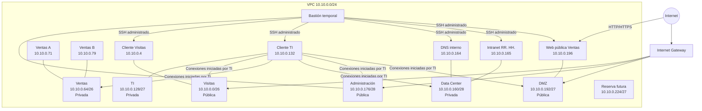

# Arquitectura de red - Fase 2

## Diagrama lógico

## Direccionamiento

| Segmento | CIDR | Tipo | Capacidad AWS | Uso principal |
|---|---|---|---:|---|
| Visitas | `10.10.0.0/26` | Pública | 59 | Internet aislado |
| Ventas | `10.10.0.64/26` | Privada | 59 | Usuarios de Ventas |
| TI | `10.10.0.128/27` | Privada | 27 | Administración y pruebas |
| Data Center | `10.10.0.160/28` | Privada | 11 | DNS e intranet |
| Administración | `10.10.0.176/28` | Pública | 11 | Bastión temporal |
| DMZ | `10.10.0.192/27` | Pública | 27 | Web pública |
| Reserva | `10.10.0.224/27` | Sin asignar | 27 | Crecimiento futuro |

## Matriz de flujos

| Origen | Destino | Flujo | Control principal | Resultado |
|---|---|---|---|---|
| Internet | Web DMZ | TCP/80 y TCP/443 opcional | SG web + NACL DMZ | Permitido |
| Internet | SSH de EC2 | TCP/22 | SG | Bloqueado |
| IP administrativa | Bastión | TCP/22 | SG bastión | Permitido |
| Bastión | EC2 internas/DMZ | TCP/22 | SG de destino | Permitido |
| Visitas | Internet | DNS, HTTP, HTTPS | SG Visitas + NACL | Permitido |
| Visitas | VPC interna | Cualquier servicio | NACL + SG | Bloqueado |
| TI | Segmentos de la VPC | Servicios disponibles | SG TI + SG destino | Permitido |
| Otras subredes | TI | Conexión iniciada | SG TI + NACL TI | Bloqueado |
| Redes autorizadas | DNS interno | UDP/53 y TCP/53 | SG DNS | Permitido |
| Ventas/TI/DC/Administración | Intranet | TCP/80 | SG intranet | Permitido |
| Visitas/DMZ/Internet | Intranet | TCP/80 | SG intranet | Bloqueado |
| DMZ | Redes internas | Conexión iniciada | NACL DMZ + SG | Bloqueado |

## Consideraciones

- Security Groups son stateful; las respuestas a conexiones permitidas se aceptan
  automáticamente.
- NACL son stateless; las reglas incluyen puertos efímeros `1024-65535` cuando se requiere
  tráfico de retorno.
- El cliente de Visitas necesita una IPv4 pública temporal porque la subred no asigna IP
  pública automáticamente y no existe NAT Gateway.
- Las instancias privadas no pueden instalar paquetes desde Internet sin una estrategia
  adicional. Los responsables de servicios deben usar una AMI preparada, artefactos locales o
  una alternativa autorizada.
- El bloque de reserva no se crea como subred; se documenta y protege contra asignaciones.
